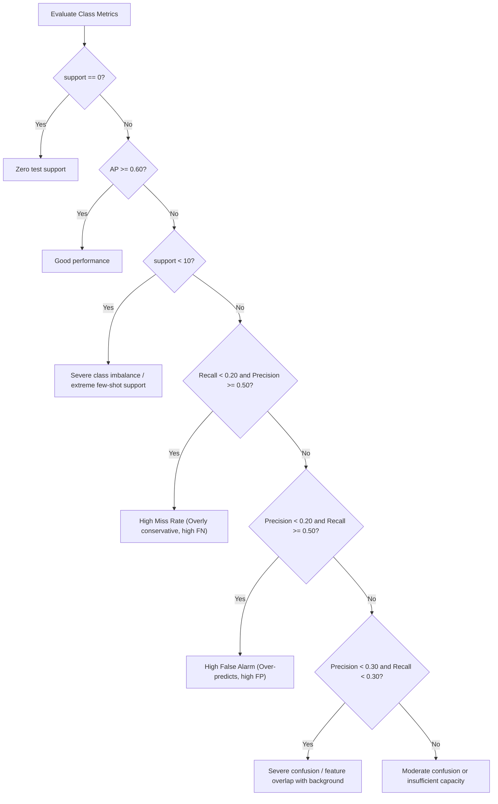

# Training Metrics Specification (`training_full_metrics.xlsx`)

This document provides a comprehensive explanation of all diagnostic, architectural, gradient, attention, and per-class classification metrics recorded in the automated training report `training_full_metrics.xlsx`.

The workbook is generated by [`utils/excel_logger.py`](file:///d:/Study/NYCU/Action-slot/action_slot/utils/excel_logger.py) during multi-epoch training and validation routines managed by [`core/engine.py`](file:///d:/Study/NYCU/Action-slot/action_slot/core/engine.py).

---

## Workbook Overview

The workbook contains four dedicated sheets:
1. [**`Epoch_Overview`**](#1-sheet-epoch_overview): Global high-level training trajectory, losses, mAP, norms, and slot attention specialization.
2. [**`Gradients_Detail`**](#2-sheet-gradients_detail): Per-module $L_2$ gradient norms to monitor gradient flow, vanishing gradients, or exploding layers.
3. [**`QKV_Attention_Dynamics`**](#3-sheet-qkv_attention_dynamics): Inner representations of the Slot Attention mechanism (Query, Key, Value statistics, Shannon entropy, slot distribution parameters).
4. [**`Per_Class_Latest`**](#4-sheet-per_class_latest): Fine-grained classification performance for all 64 individual traffic actor action classes (AP, Precision, Recall, Confusion Matrix counts, and root cause diagnosis).

---

## 1. Sheet: `Epoch_Overview`

This sheet summarizes the macroscopic progression of the training process at the boundary of each epoch.

| Column Header | Data Type | Formula / Source | Detailed Explanation & Diagnostic Significance |
| :--- | :--- | :--- | :--- |
| **`Epoch`** | Integer | $1, 2, \dots, N$ | Current training epoch index. |
| **`Train_Loss`** | Float | Mean batch loss over epoch | Average composite loss over the training dataset for the current epoch (weighted sum of actor classification loss, ego action loss, etc.). A steadily declining loss indicates stable convergence. |
| **`Val_Loss`** | Float | Mean validation loss | Average composite loss evaluated on the validation set. If `Train_Loss` decreases while `Val_Loss` increases, the model is overfitting. |
| **`Train_mAP`** | Float | Mean AP across actor classes | Mean Average Precision computed across all 64 actor action classes on the training split. |
| **`Val_mAP`** | Float | Mean AP across actor classes | Mean Average Precision on the validation set. **Primary metric for model evaluation and checkpoint selection.** |
| **`LR`** | Float | Optimizer param groups | Current learning rate applied by the scheduler for the epoch. |
| **`Total_Grad_Norm`** | Float | $\|\mathbf{g}\|_2 = \sqrt{\sum_i \|\mathbf{g}_i\|_2^2}$ | Global $L_2$ norm of all parameter gradients captured immediately before gradient clipping or optimizer stepping. Values $> 5.0$ indicate high instability or gradient spikes; values $< 10^{-4}$ indicate gradient vanishing. |
| **`Total_Param_Norm`** | Float | $\|\mathbf{\theta}\|_2 = \sqrt{\sum_i \|\mathbf{\theta}_i\|_2^2}$ | Global $L_2$ norm of all trainable model weights. Gradual growth is normal; rapid divergence indicates unregularized weight explosion. |
| **`Q_Norm`** | Float | $\frac{1}{B \cdot S}\sum \|\mathbf{q}\|_2$ | Average vector norm of Query representations in Slot Attention. Represents the feature magnitude of the learned slot queries. |
| **`K_Norm`** | Float | $\frac{1}{B \cdot N}\sum \|\mathbf{k}\|_2$ | Average vector norm of Key representations projected from spatiotemporal backbone feature maps ($T \times H \times W$). |
| **`V_Norm`** | Float | $\frac{1}{B \cdot N}\sum \|\mathbf{v}\|_2$ | Average vector norm of Value vectors projected from video features. |
| **`Slot_Attn_Entropy`** | Float | $-\sum p \ln(p)$ | Shannon entropy of the attention distribution averaged across slots and batches. Measures attention sharpness: **high entropy** means diffuse/uniform attention across the scene, while **low entropy** indicates sharp localization on specific objects/regions. |

---

## 2. Sheet: `Gradients_Detail`

Monitors the backward propagation dynamics across individual sub-networks to verify that each architectural module learns at balanced rates.

$$\|\mathbf{g}_{\text{module}}\|_2 = \sqrt{\sum_{\mathbf{w} \in \text{module}} \|\nabla_{\mathbf{w}} \mathcal{L}\|_2^2}$$

| Column Header | Sub-network Module | Diagnostic Meaning & Target Range |
| :--- | :--- | :--- |
| **`Epoch`** | — | Epoch index corresponding to the recorded gradient step. |
| **`Total_Grad_Norm`** | Entire Model | Aggregated global gradient norm across all trainable parameters. |
| **`grad_norm_backbone`** | Video Backbone (`backbone`) | Gradient norm flowing through the 3D backbone (e.g., X3D / SlowFast / ResNet3D). Should be stable ($0.05 \sim 0.5$). If frozen during fine-tuning, this will be $0.0$. |
| **`grad_norm_conv3d_ego`**| Ego Feature Extractor (`conv3d_ego`) | Gradient norm updating the ego-vehicle temporal feature projection layers. |
| **`grad_norm_conv3d`** | Temporal / Spatial Conv Layers (`conv3d`) | Gradient magnitude updating spatiotemporal dimensionality reduction layers before Slot Attention. |
| **`grad_norm_slot_attention`** | Slot Attention Engine (`slot_attention`) | Gradient norm updating iterative slot cross-attention weights, GRU updates, and slot projection matrices ($W_q, W_k, W_v$). Low values ($< 0.01$) suggest slot updates are stalled. |
| **`grad_norm_head`** | Prediction Head (`head`) | Gradient norm updating classification heads (Linear, Deformable Slot Temporal Head, or MLP). Typically exhibits the highest gradient norm ($0.3 \sim 1.0$) because classification loss is applied directly to its outputs. |

---

## 3. Sheet: `QKV_Attention_Dynamics`

Tracks internal representations and attention mechanics inside the Slot Attention mechanism to detect representation collapse, query saturation, or attention blurring.

| Metric Column | Mathematical Definition | Interpretation & Health Check |
| :--- | :--- | :--- |
| **`Epoch`** | — | Epoch index. |
| **`q_norm_mean`** | $\mathbb{E}[\|\mathbf{q}\|_2]$ | Mean $L_2$ norm of slot query vectors. Should remain numerically stable throughout training. |
| **`q_std`** | $\operatorname{std}(\mathbf{q})$ | Standard deviation of query values across dimensions. Healthy range: $0.4 \sim 0.9$. |
| **`q_mean`** | $\operatorname{mean}(\mathbf{q})$ | Mean scalar activation of query vectors (expected to center near $0.0$). |
| **`k_norm_mean`** | $\mathbb{E}[\|\mathbf{k}\|_2]$ | Mean $L_2$ norm of visual key vectors. |
| **`k_std`** | $\operatorname{std}(\mathbf{k})$ | Standard deviation of key values. |
| **`k_mean`** | $\operatorname{mean}(\mathbf{k})$ | Mean activation of key values (centers near $0.0$). |
| **`v_norm_mean`** | $\mathbb{E}[\|\mathbf{v}\|_2]$ | Mean $L_2$ norm of feature value vectors. Reflects visual signal scale aggregated into slots. |
| **`v_std`** | $\operatorname{std}(\mathbf{v})$ | Standard deviation of value vectors. |
| **`v_mean`** | $\operatorname{mean}(\mathbf{v})$ | Mean scalar value across value vectors. |
| **`attn_entropy`** | $-\frac{1}{B \cdot S}\sum_{b,s} \sum_j \bar{a}_{b,s,j} \ln(\bar{a}_{b,s,j} + \epsilon)$ | **Shannon Attention Entropy**: Decreasing entropy over epochs is desirable as slots become selective and bind to distinct traffic participants instead of averaging the background. |
| **`attn_peak_max`** | $\max(A_{b,s,j})$ | Maximum attention weight across the entire attention tensor. Increasing values ($> 0.5$) show sharp, decisive slot binding. |
| **`attn_mean`** | $\operatorname{mean}(A_{b,s,j}) = \frac{1}{N_{patches}}$ | Mean baseline attention probability. Uniform baseline is approximately $\frac{1}{T \times H \times W}$ (e.g., $\frac{1}{16 \times 8 \times 24} \approx 0.0003$). |
| **`slots_mu_norm`** | $\|\mathbf{\mu}_{\text{slot}}\|_2$ | $L_2$ norm of the learnable slot initialization prior mean $\mathbf{\mu} \in \mathbb{R}^{D}$. |
| **`slots_sigma_norm`** | $\|\mathbf{\sigma}_{\text{slot}}\|_2$ | $L_2$ norm of the slot initialization variance parameter $\mathbf{\sigma} \in \mathbb{R}^{D}$. |

---

## 4. Sheet: `Per_Class_Latest`

Provides a granular breakdown of evaluation metrics for each of the 64 actor action classes defined in the TACO benchmark.

### Core Metrics Table

| Column Header | Mathematical Formula | Explanation |
| :--- | :--- | :--- |
| **`Epoch`** | — | Epoch at which evaluation occurred. |
| **`class_id`** | $0, 1, \dots, 63$ | Internal index corresponding to actor action slot. |
| **`name`** | String (e.g. `c:z1-z2`) | Human-readable canonical TACO label: Category (`c`: car, `b`: bus/truck, `p`: pedestrian, `+`: turning/crossing) and zone transition (e.g., `z1-z2`). |
| **`support`** | $\sum_i y_i$ | Total number of positive ground-truth instances present in the evaluation dataset. |
| **`predicted_pos`**| $\sum_i \mathbb{I}(\hat{y}_i \ge \tau)$ | Total number of samples predicted as positive by the model (threshold $\tau = 0.5$). |
| **`ap`** | $\int_0^1 p(r) \, dr$ | **Average Precision (AP)**: Area under the Precision-Recall curve for this class. Primary per-class performance metric. |
| **`precision`** | $\frac{\text{TP}}{\text{TP} + \text{FP}}$ | Proportion of predicted positive actions that were actually correct. High precision means very few false alarms. |
| **`recall`** | $\frac{\text{TP}}{\text{TP} + \text{FN}}$ | Proportion of true ground-truth actions that were successfully retrieved by the model. High recall means very few missed actions. |
| **`f1`** | $\frac{2 \cdot \text{Precision} \cdot \text{Recall}}{\text{Precision} + \text{Recall}}$ | Harmonic mean of precision and recall, balancing false alarms against missed detections. |
| **`tp`** | $\sum \mathbb{I}(\hat{y}=1 \land y=1)$ | **True Positives**: Correctly detected action instances. |
| **`fp`** | $\sum \mathbb{I}(\hat{y}=1 \land y=0)$ | **False Positives**: False alarms where the model hallucinated an action that did not occur. |
| **`fn`** | $\sum \mathbb{I}(\hat{y}=0 \land y=1)$ | **False Negatives**: Missed detections where the action occurred but the model failed to detect it. |
| **`tn`** | $\sum \mathbb{I}(\hat{y}=0 \land y=0)$ | **True Negatives**: Correctly identified negative samples. |
| **`primary_issue`** | Rule-based Diagnosis | Automated failure mode categorization generated by [`PerformanceTracker`](file:///d:/Study/NYCU/Action-slot/action_slot/utils/tracker.py). |

---

### Diagnosis Rules for `primary_issue`

The diagnostic engine automatically classifies failure modes based on class support, AP, precision, and recall:

1. **`Zero test support`**: Ground truth contains 0 samples in this evaluation split.
2. **`Good performance`**: $AP \ge 0.60$.
3. **`Severe class imbalance / extreme few-shot support`**: Support $< 10$ instances; sample size is too small for statistical generalization.
4. **`High Miss Rate`**: Low recall ($< 0.2$) with moderate/high precision ($\ge 0.5$). The model is overly hesitant and misses real events.
5. **`High False Alarm`**: Low precision ($< 0.2$) with high recall ($\ge 0.5$). The model triggers frequently on false leads.
6. **`Severe confusion / feature overlap with background or other classes`**: Both precision and recall are low ($< 0.3$). Features of this actor action cannot be distinguished from background or similar motions.
7. **`Moderate confusion or insufficient capacity`**: Intermediate failure requiring longer training, loss reweighting, or higher capacity.
