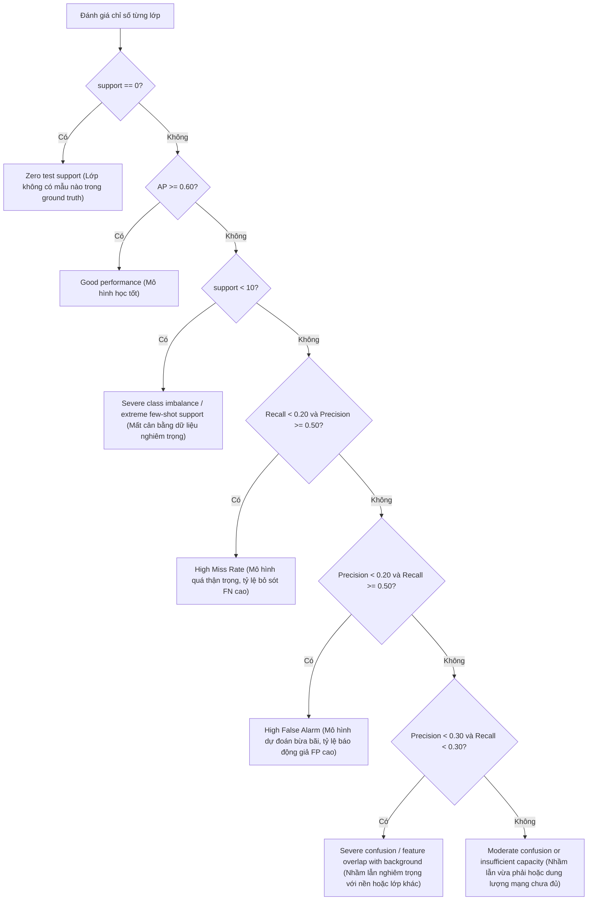

# Tài Liệu Giải Thích Các Thông Số Đo Lường (`training_full_metrics.xlsx`)

Tài liệu này cung cấp hướng dẫn và giải thích chi tiết toàn bộ các chỉ số thống kê, tham số huấn luyện, chuẩn gradient, động lực học Attention (Q/K/V) và độ chính xác phân loại theo từng lớp có trong file báo cáo Excel `training_full_metrics.xlsx`.

Workbook này được sinh tự động bởi module [`utils/excel_logger.py`](file:///d:/Study/NYCU/Action-slot/action_slot/utils/excel_logger.py) sau mỗi epoch trong quá trình huấn luyện và đánh giá được điều phối bởi [`core/engine.py`](file:///d:/Study/NYCU/Action-slot/action_slot/core/engine.py).

---

## Cấu Trúc Tổng Quan Của File Excel

Workbook gồm 4 sheet chuyên biệt:
1. [**`Epoch_Overview`**](#1-sheet-epoch_overview): Toàn cảnh quá trình huấn luyện tổng quát qua các epoch (Loss, mAP, Learning Rate, Norm của trọng số, Norm của Gradient, entropy của slot attention).
2. [**`Gradients_Detail`**](#2-sheet-gradients_detail): Độ lớn gradient ($L_2$ norm) của từng submodule kiến trúc nhằm giám sát hiện tượng triệt tiêu (vanishing) hoặc bùng nổ gradient (exploding).
3. [**`QKV_Attention_Dynamics`**](#3-sheet-qkv_attention_dynamics): Các thông số đặc trưng bên trong cơ chế Slot Attention (phân phối Query, Key, Value, entropy Shannon, thông số khởi tạo slot).
4. [**`Per_Class_Latest`**](#4-sheet-per_class_latest): Chi tiết hiệu năng phân loại của toàn bộ 64 lớp hành động Actor trên tập validation (AP, Precision, Recall, Confusion Matrix, và chẩn đoán nguyên nhân lỗi).

---

## 1. Sheet: `Epoch_Overview`

Sheet này ghi lại tiến trình tổng thể của mô hình sau mỗi epoch huấn luyện.

| Tên Cột | Kiểu Dữ Liệu | Công Thức / Nguồn | Giải Thích Chi Tiết & Ý Nghĩa Chẩn Đoán |
| :--- | :--- | :--- | :--- |
| **`Epoch`** | Số nguyên | $1, 2, \dots, N$ | Chỉ số epoch huấn luyện hiện tại. |
| **`Train_Loss`** | Số thực | Trung bình loss các batch | Giá trị hàm mất mát tổng hợp trung bình trên tập train trong epoch (bao gồm loss phân loại actor, ego action loss, ...). Giảm đều đặn chứng tỏ mô hình đang hội tụ tốt. |
| **`Val_Loss`** | Số thực | Trung bình loss tập validation | Giá trị hàm mất mát trên tập kiểm định (validation). Nếu `Train_Loss` tiếp tục giảm nhưng `Val_Loss` tăng liên tục, mô hình đang gặp hiện tượng quá khớp (overfitting). |
| **`Train_mAP`** | Số thực | Trung bình AP các lớp trên train | Độ chính xác trung bình mAP (Mean Average Precision) tính trên tất cả 64 lớp hành động actor của tập train. |
| **`Val_mAP`** | Số thực | Trung bình AP các lớp trên val | Độ chính xác trung bình mAP tính trên tập validation. **Đây là thước đo quan trọng nhất để đánh giá chất lượng mô hình và lựa chọn checkpoint tốt nhất (best checkpoint).** |
| **`LR`** | Số thực | Learning rate từ optimizer | Tốc độ học (learning rate) hiện tại đang áp dụng cho epoch. |
| **`Total_Grad_Norm`** | Số thực | $\|\mathbf{g}\|_2 = \sqrt{\sum_i \|\mathbf{g}_i\|_2^2}$ | Chuẩn $L_2$ tổng thể của gradient toàn bộ tham số mô hình ngay trước khi cập nhật optimizer (hoặc trước khi clip gradient). Giá trị $> 5.0$ cảnh báo dao động gradient mạnh; giá trị $< 10^{-4}$ cảnh báo triệt tiêu gradient. |
| **`Total_Param_Norm`**| Số thực | $\|\mathbf{\theta}\|_2 = \sqrt{\sum_i \|\mathbf{\theta}_i\|_2^2}$ | Chuẩn $L_2$ tổng của tất cả trọng số khả huấn (learnable weights). Giá trị tăng từ từ là bình thường; nếu tăng vọt đột ngột là dấu hiệu bùng nổ trọng số do thiếu kiểm soát regularization. |
| **`Q_Norm`** | Số thực | $\frac{1}{B \cdot S}\sum \|\mathbf{q}\|_2$ | Độ lớn vector trung bình của các Query trong Slot Attention. Đo lường cường độ biểu diễn của các slot query đã học. |
| **`K_Norm`** | Số thực | $\frac{1}{B \cdot N}\sum \|\mathbf{k}\|_2$ | Độ lớn vector trung bình của các Key được chiếu từ không-thời gian ($T \times H \times W$) của backbone video. |
| **`V_Norm`** | Số thực | $\frac{1}{B \cdot N}\sum \|\mathbf{v}\|_2$ | Độ lớn vector trung bình của các Value được trích xuất từ đặc trưng video. |
| **`Slot_Attn_Entropy`** | Số thực | $-\sum p \ln(p)$ | Độ hỗn loạn thông tin (Shannon entropy) trung bình của ma trận Attention. **Entropy cao**: Attention phân bố đều/lan man khắp khung hình. **Entropy thấp**: Attention tập trung sắc nét vào các vùng đối tượng cụ thể. |

---

## 2. Sheet: `Gradients_Detail`

Giám sát luồng gradient lan truyền ngược vào từng khối module riêng biệt để phát hiện điểm nghẽn hoặc mất cân bằng tốc độ học giữa các tầng.

$$\|\mathbf{g}_{\text{module}}\|_2 = \sqrt{\sum_{\mathbf{w} \in \text{module}} \|\nabla_{\mathbf{w}} \mathcal{L}\|_2^2}$$

| Tên Cột | Khối Mạng Tương Ứng | Ý Nghĩa Chẩn Đoán & Ngưỡng Kỳ Vọng |
| :--- | :--- | :--- |
| **`Epoch`** | — | Chỉ số epoch được ghi nhận. |
| **`Total_Grad_Norm`** | Toàn bộ mô hình | Tổng độ lớn gradient kết hợp của tất cả tham số. |
| **`grad_norm_backbone`** | Backbone Video (`backbone`) | Độ lớn gradient chảy qua mạng trích xuất 3D (X3D, SlowFast, hoặc ResNet3D). Khoảng ổn định thường nằm trong khoảng $0.05 \sim 0.5$. Nếu đóng băng backbone (freeze khi finetune), giá trị này sẽ bằng $0.0$. |
| **`grad_norm_conv3d_ego`**| Tầng chiếu Ego (`conv3d_ego`) | Gradient cập nhật các tầng tích chập trích xuất tín hiệu thời gian cho xe tự hành (ego-vehicle). |
| **`grad_norm_conv3d`** | Tầng nén chiều không-thời gian (`conv3d`) | Gradient cập nhật các lớp tích chập chuẩn hóa số chiều trước khi đưa vào Slot Attention. |
| **`grad_norm_slot_attention`** | Cơ chế Slot Attention (`slot_attention`) | Gradient cập nhật các ma trận chiếu $W_q, W_k, W_v$, tầng cập nhật GRU và MLP của slot. Nếu giá trị quá bé ($< 0.01$), các slot khó thích nghi với dữ liệu mới. |
| **`grad_norm_head`** | Đầu phân loại (`head`) | Gradient cập nhật các tầng dự đoán phân loại (Linear, Deformable Slot Temporal Head). Thông thường có chuẩn gradient lớn nhất ($0.3 \sim 1.0$) do nhận trực tiếp tín hiệu từ loss. |

---

## 3. Sheet: `QKV_Attention_Dynamics`

Theo dõi chi tiết các chỉ số nội tại của cơ chế Slot Attention nhằm phát hiện sớm các hiện tượng: sụp đổ biểu diễn (representation collapse), bão hòa query, hoặc ma trận attention bị mờ nhạt.

| Tên Chỉ Số | Định Nghĩa Toán Học | Ý Nghĩa Chẩn Đoán |
| :--- | :--- | :--- |
| **`Epoch`** | — | Chỉ số epoch. |
| **`q_norm_mean`** | $\mathbb{E}[\|\mathbf{q}\|_2]$ | Độ lớn $L_2$ trung bình của các vector Slot Query. Cần duy trì ổn định qua các epoch. |
| **`q_std`** | $\operatorname{std}(\mathbf{q})$ | Độ lệch chuẩn của các giá trị trong query. Ngưỡng khỏe mạnh: $0.4 \sim 0.9$. |
| **`q_mean`** | $\operatorname{mean}(\mathbf{q})$ | Giá trị trung bình đại số của query (kỳ vọng dao động quanh $0.0$). |
| **`k_norm_mean`** | $\mathbb{E}[\|\mathbf{k}\|_2]$ | Độ lớn $L_2$ trung bình của các vector Key. |
| **`k_std`** | $\operatorname{std}(\mathbf{k})$ | Độ lệch chuẩn của các giá trị trong key. |
| **`k_mean`** | $\operatorname{mean}(\mathbf{k})$ | Giá trị trung bình của key (dao động gần $0.0$). |
| **`v_norm_mean`** | $\mathbb{E}[\|\mathbf{v}\|_2]$ | Độ lớn $L_2$ trung bình của các vector Value, phản ánh cường độ tín hiệu hình ảnh được nạp vào slot. |
| **`v_std`** | $\operatorname{std}(\mathbf{v})$ | Độ lệch chuẩn của vector value. |
| **`v_mean`** | $\operatorname{mean}(\mathbf{v})$ | Giá trị trung bình của vector value. |
| **`attn_entropy`** | $-\frac{1}{B \cdot S}\sum_{b,s} \sum_j \bar{a}_{b,s,j} \ln(\bar{a}_{b,s,j} + \epsilon)$ | **Shannon Attention Entropy**: Xu hướng giảm dần qua các epoch chứng tỏ các slot đang dần chuyên môn hóa (specialization), tập trung vào các tác tử cụ thể thay vì phân bổ mờ khắp nền xe cộ. |
| **`attn_peak_max`** | $\max(A_{b,s,j})$ | Trọng số attention cực đại trên toàn tensor. Giá trị tăng cao ($> 0.5$) phản ánh slot đã khoanh vùng dứt khoát đối tượng. |
| **`attn_mean`** | $\operatorname{mean}(A_{b,s,j}) = \frac{1}{N_{patches}}$ | Xác suất attention cơ bản trung bình. Với kích thước không thời gian $16 \times 8 \times 24$, mức đều là $\approx 0.0003$. |
| **`slots_mu_norm`** | $\|\mathbf{\mu}_{\text{slot}}\|_2$ | Chuẩn $L_2$ của tham số kỳ vọng khởi tạo slot $\mathbf{\mu} \in \mathbb{R}^{D}$. |
| **`slots_sigma_norm`**| $\|\mathbf{\sigma}_{\text{slot}}\|_2$ | Chuẩn $L_2$ của tham số phương sai khởi tạo slot $\mathbf{\sigma} \in \mathbb{R}^{D}$. |

---

## 4. Sheet: `Per_Class_Latest`

Cung cấp báo cáo chi tiết về năng lực phân loại của từng lớp trong 64 lớp hành động tác tử giao thông của tập dữ liệu TACO tại lần kiểm định gần nhất.

### Bảng Ý Nghĩa Các Cột Số Liệu

| Tên Cột | Công Thức Toán Học | Ý Nghĩa Thực Tế |
| :--- | :--- | :--- |
| **`Epoch`** | — | Epoch tại thời điểm đánh giá. |
| **`class_id`** | $0, 1, \dots, 63$ | Mã số ID của lớp hành động tác tử. |
| **`name`** | Chuỗi (VD: `c:z1-z2`) | Nhãn chuẩn hóa TACO: Phân loại đối tượng (`c`: xe ô tô, `b`: xe buýt/tải, `p`: người đi bộ, `+`: chuyển làn/rẽ) kèm hướng dịch chuyển vùng (VD: từ vùng `z1` sang `z2`). |
| **`support`** | $\sum_i y_i$ | Tổng số mẫu thực tế (Ground Truth positive) xuất hiện trong tập kiểm định. |
| **`predicted_pos`**| $\sum_i \mathbb{I}(\hat{y}_i \ge \tau)$ | Tổng số mẫu mà mô hình dự đoán là dương tính (với ngưỡng $\tau = 0.5$). |
| **`ap`** | $\int_0^1 p(r) \, dr$ | **Average Precision (AP)**: Diện tích dưới đường cong Precision-Recall của riêng lớp này. Đây là chỉ số đánh giá cốt lõi cho từng lớp. |
| **`precision`** | $\frac{\text{TP}}{\text{TP} + \text{FP}}$ | Độ chuẩn xác: Trong số các mẫu mô hình báo có hành động, có bao nhiêu % là đúng thực tế. |
| **`recall`** | $\frac{\text{TP}}{\text{TP} + \text{FN}}$ | Độ bao phủ: Trong số các mẫu thực tế có xảy ra hành động, mô hình phát hiện được bao nhiêu %. |
| **`f1`** | $\frac{2 \cdot \text{Precision} \cdot \text{Recall}}{\text{Precision} + \text{Recall}}$ | Trung bình điều hòa giữa Precision và Recall. |
| **`tp`** | $\sum \mathbb{I}(\hat{y}=1 \land y=1)$ | **True Positives**: Số lần mô hình phát hiện ĐÚNG khi hành động có xảy ra. |
| **`fp`** | $\sum \mathbb{I}(\hat{y}=1 \land y=0)$ | **False Positives**: Báo động giả (thực tế không có nhưng mô hình đoán có). |
| **`fn`** | $\sum \mathbb{I}(\hat{y}=0 \land y=1)$ | **False Negatives**: Bỏ sót (thực tế có xảy ra nhưng mô hình không nhận diện được). |
| **`tn`** | $\sum \mathbb{I}(\hat{y}=0 \land y=0)$ | **True Negatives**: Nhận diện âm tính chính xác. |
| **`primary_issue`** | Phân loại tự động | Nguyên nhân chính dẫn đến lỗi hoặc trạng thái của lớp do [`PerformanceTracker`](file:///d:/Study/NYCU/Action-slot/action_slot/utils/tracker.py) chuẩn đoán. |

---

### Cây Quyết Định Chẩn Đoán Lỗi (`primary_issue`)

Hệ thống phân tích tự động gán nhãn chẩn đoán lỗi theo lưu đồ sau:

#### Ý Nghĩa Chi Tiết Từng Loại Chẩn Đoán:
1. **`Zero test support`**: Tập validation không chứa mẫu nào của lớp này $\to$ Cần cập nhật phân chia tập dữ liệu hoặc bổ sung dữ liệu kiểm thử.
2. **`Good performance`**: Lớp đạt hiệu năng tốt ($AP \ge 0.60$).
3. **`Severe class imbalance / extreme few-shot support`**: Lớp có dưới 10 mẫu ground truth $\to$ Cần áp dụng oversampling, class weight, hoặc focal loss.
4. **`High Miss Rate`**: Precision cao ($\ge 0.5$) nhưng Recall thấp ($< 0.2$) $\to$ Mô hình quá khắt khe, cần hạ ngưỡng quyết định threshold hoặc tăng trọng số phạt False Negative.
5. **`High False Alarm`**: Recall cao ($\ge 0.5$) nhưng Precision thấp ($< 0.2$) $\to$ Mô hình kích hoạt quá nhiều, cần tăng ngưỡng threshold hoặc bổ sung mẫu negative để lọc nhiễu.
6. **`Severe confusion / feature overlap with background or other classes`**: Cả Precision và Recall đều dưới 0.3 $\to$ Đặc trưng hình ảnh/chuyển động của hành động bị chìm vào nền hoặc trùng lắp với các hành động tương tự.
7. **`Moderate confusion or insufficient capacity`**: Cần tăng số epoch huấn luyện hoặc tăng độ phân giải / dung lượng mô hình.
