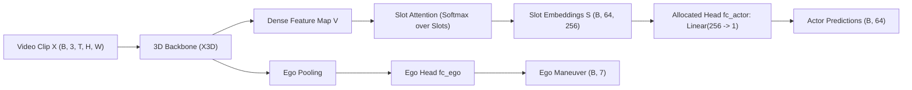
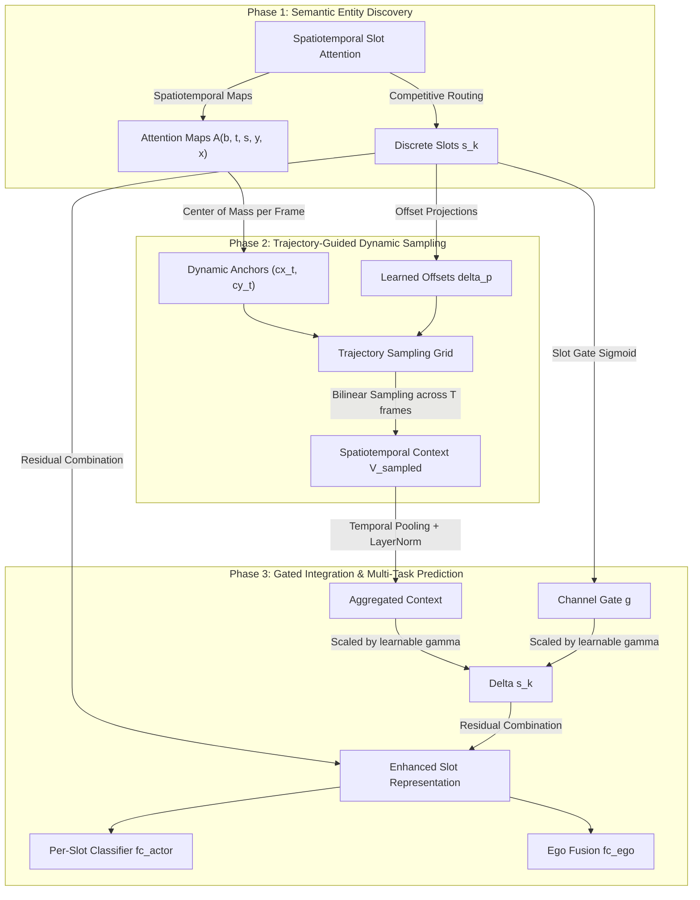

# Technical Report: Deformable Spatiotemporal Slot Detection Head (`DeformableSlotTemporalDetectionHead`)

---

## Executive Summary

This report provides a formal mathematical and architectural description of the **`DeformableSlotTemporalDetectionHead`**, developed for fine-grained interactive action detection in autonomous driving scenarios (the TACO dataset). We examine the legacy Action-Slot framework equipped with the static **Allocated Head**, formalize the theoretical limitations of classical **Slot Attention** (spatial rigidity, feature dilution, and background contamination), analyze the constraints of unconstrained **Deformable Attention** (loss of entity identity, gradient dominance), and detail how their synergistic integration resolves these challenges. Finally, we formalize the recent spatiotemporal per-frame sampling formulation and its cross-modal ego-action prediction mechanism.

---

## 1. Baseline Framework: The Action-Slot Model with Allocated Head

### 1.1 Action-Slot Video Pipeline
The standard Action-Slot architecture models video clips $\mathbf{X} \in \mathbb{R}^{B \times 3 \times T \times H \times W}$ through three sequential components:
1. **Spatiotemporal 3D Backbone**: A 3D convolutional network (e.g., X3D) extracts a dense spatiotemporal feature representation $\mathbf{F} \in \mathbb{R}^{B \times C \times T' \times H' \times W'}$.
2. **Channel Projection**: A $1\times 1\times 1$ 3D convolution maps $\mathbf{F}$ to the slot feature dimension $D = 256$, yielding $\mathbf{V} \in \mathbb{R}^{B \times T' \times H' \times W' \times D}$.
3. **Spatiotemporal Slot Attention**: An iterative clustering module groups dense continuous spatiotemporal tokens into a set of discrete slot embeddings $\mathbf{S} \in \mathbb{R}^{B \times K \times D}$, where $K = 64$ corresponds to semantic object-action interaction classes.

### 1.2 The Legacy Allocated Head
In the legacy Action-Slot architecture, each slot $k \in \{1, \dots, K\}$ is statically assigned to predict interaction class $k$:
$$\hat{y}_k^{\text{actor}} = \mathbf{w}^T \mathbf{s}_k + b, \quad \mathbf{w} \in \mathbb{R}^D, \; b \in \mathbb{R}$$
The ego vehicle's maneuver $\hat{\mathbf{y}}^{\text{ego}} \in \mathbb{R}^7$ is predicted via a decoupled branch operating on an independently pooled global feature $\mathbf{e} \in \mathbb{R}^{C_{\text{ego}}}$:
$$\hat{\mathbf{y}}^{\text{ego}} = \mathbf{W}_{\text{ego}} \mathbf{e} + \mathbf{b}_{\text{ego}}$$

---

## 2. Inherent Limitations of Classical Slot Attention

Slot Attention is founded on iterative competitive routing where queries (slots) compete for keys (spatiotemporal tokens) via a softmax computed across slots:
$$A_{i, j} = \frac{\exp\left(\frac{\mathbf{q}_i^T \mathbf{k}_j}{\sqrt{D}}\right)}{\sum_{l=1}^K \exp\left(\frac{\mathbf{q}_l^T \mathbf{k}_j}{\sqrt{D}}\right)}$$
The fundamental bottleneck lies within the **representational capacity and pooling mechanics** of the slot representations themselves:

1. **Resolution and Boundary Dilution (Convex Combination Bottleneck)**:
   Once competitive routing completes, the slot embedding $\mathbf{s}_i$ is formed purely as a global weighted average (convex combination) over the entire spatiotemporal volume:
   $$\mathbf{s}_i = \sum_{j} \tilde{A}_{i, j} \mathbf{v}_j, \quad \text{where } \tilde{A}_{i, j} = \frac{A_{i, j}}{\sum_{j'} A_{i, j'}}$$
   Because $\tilde{A}_{i, j}$ inevitably forms a diffuse spatial envelope over the detected actor and its surrounding margins, high-frequency boundary cues, subtle vehicle body contours, and localized motion signals (such as pedestrian leg gait or vehicle turn signals) are smoothed out. The slot represents an *aggregate spatial centroid* rather than an articulated, structure-aware entity.

2. **Temporal Smearing across Dynamic Trajectories**:
   In interactive driving scenarios, an actor traverses a significant trajectory across $T$ frames (e.g., from zone $z_1$ to $z_3$). A single static vector $\mathbf{s}_i \in \mathbb{R}^D$ must simultaneously summarize the actor's appearance, spatial origin, instantaneous heading, and destination. Because slot aggregation pools indiscriminately across the temporal dimension $T$, it suffers from severe temporal smearing: the slot captures *that* an entity moved, but struggles to preserve the fine-grained sequence of trajectory waypoints required to disambiguate subtle opposing interactions (e.g., distinguishing $z_1 \to z_2$ from $z_2 \to z_1$).

3. **Information Capacity Bottleneck under Extreme Actor Diversity**:
   Compressing an entire dynamic actor over 16 video frames into a fixed 256-dimensional vector creates an expressive capacity ceiling. When scenes contain multiple interacting actors of varying scales (small distant pedestrians vs. large cutting-in buses), the slot representation lacks the capacity to adaptively zoom into localized sub-features or re-sample critical visual evidence at the decision boundary.

4. **Frozen Initialization Bottleneck**:
   In conventional implementations, initializing queries via a fixed buffer `register_buffer("slots", ...)` prevents gradient backpropagation into query parameters, forcing the entire representational burden onto the linear projection matrices $\mathbf{W}_q, \mathbf{W}_k, \mathbf{W}_v$.

---

## 3. Inherent Limitations of Deformable Attention

Deformable Attention (as popularized in Deformable DETR) replaces dense all-to-all attention with a sparse set of $N_p$ learned sampling offsets centered around a reference point $\mathbf{p} = (c_x, c_y)$:
$$\text{DeformAttn}(\mathbf{q}, \mathbf{p}, \mathbf{x}) = \sum_{m=1}^{M} \mathbf{W}_m \sum_{p=1}^{N_p} A_{m, p} \cdot \mathbf{W}'_m \mathbf{x}\left(\mathbf{p} + \Delta \mathbf{p}_{m, p}\right)$$

When applied in isolation without an object-centric inductive bias, deformable attention suffers from:
1. **Lack of Entity Separation**: Sampling points can wander freely across the feature map, frequently latching onto high-frequency road textures or adjacent vehicles, causing severe false positive alarms ($\text{FP}$).
2. **Gradient Dominance & Catastrophic Overwrite**: Because the bilinear grid sampling connects directly to high-capacity backbone features, the deformable aggregation branch easily develops feature norms $2.5\times$ to $3.0\times$ larger than the slot vectors. This overwhelms the semantic identity of the slot queries, causing the network to degenerate into a standard dense CNN.

---

## 4. Mutual Synergy: How Slot Attention and Deformable Attention Complement Each Other

The synthesis of Slot Attention and Deformable Attention creates a mutually beneficial inductive loop:

| Dimension | Classical Slot Attention | Unconstrained Deformable Head | Synergistic `DeformableSlotHead` |
| :--- | :--- | :--- | :--- |
| **Spatial Localization** | Diffuse, soft attention blobs | Free-floating offsets without global anchor | **Attention-Guided Anchors**: Offsets originate from slot center-of-mass |
| **Feature Granularity** | Low (global weighted average) | High (sub-pixel bilinear interpolation) | **High**: Slot provides identity; Deformable retrieves fine details |
| **Object Semantics** | High (entity-level routing) | Weak (pixel-level sampling) | **Preserved**: Slot remains the primary semantic carrier |
| **Optimization Stability** | Stable but low capacity | Susceptible to gradient explosion/wandering | **Stabilized**: Constrained by LayerScale Gating ($\gamma$) & GradScale |

---

## 5. Architectural Formalism of `DeformableSlotTemporalDetectionHead`

The upgraded `DeformableSlotTemporalDetectionHead` operates through five rigorous stages:

### Stage 1: Dynamic Spatiotemporal Trajectory Anchoring
Rather than collapsing the 16-frame clip into a static 2D average, the head computes the instantaneous center-of-mass trajectory $(c_{x, t, s}, c_{y, t, s})$ for each slot $s$ at every frame $t \in \{1, \dots, T\}$:
$$P(t, s, y, x) = \frac{A(t, s, y, x)}{\sum_{y'=1}^H \sum_{x'=1}^W A(t, s, y', x') + \epsilon}$$
$$c_{x, t, s} = \sum_{y=1}^H \sum_{x=1}^W P(t, s, y, x) \cdot x_{\text{norm}}, \quad c_{y, t, s} = \sum_{y=1}^H \sum_{x=1}^W P(t, s, y, x) \cdot y_{\text{norm}}$$
$$\mathbf{p}_{t, s}^{\text{base}} = \left(c_{x, t, s}, \; c_{y, t, s}\right) \in [-1, 1]^2$$

### Stage 2: Multi-Head Frame-Wise Deformable Sampling
Slot embeddings generate sampling offsets $\Delta \mathbf{p}$ and attention weights $\mathbf{w}$:
$$\Delta \mathbf{p}_s = \tanh\left(\mathbf{W}_{\text{offset}} \mathbf{s}_s + \mathbf{b}_{\text{offset}}\right) \in \mathbb{R}^{M \times N_p \times 2}$$
$$w_{s, m, p} = \frac{\exp\left(\mathbf{W}_{\text{weight}} \mathbf{s}_s\right)_{m, p}}{\sum_{p'=1}^{N_p} \exp\left(\mathbf{W}_{\text{weight}} \mathbf{s}_s\right)_{m, p'}}$$

Sampling grids are evaluated across all $T$ frames simultaneously via parallel batch-flattening:
$$\mathbf{g}_{t, s, m, p} = \mathbf{p}_{t, s}^{\text{base}} + 0.2 \cdot \Delta \mathbf{p}_{s, m, p}$$
$$\mathbf{v}^{\text{sampled}}_{t, s, m, p} = \text{GridSample}\left(\mathbf{V}_t, \; \mathbf{g}_{t, s, m, p}\right)$$

### Stage 3: Temporal Aggregation and Gated Residual Integration
Sampled features are weighted across heads and points, then pooled across time:
$$\mathbf{z}_{t, s} = \sum_{m=1}^M \sum_{p=1}^{N_p} w_{s, m, p} \cdot \mathbf{v}^{\text{sampled}}_{t, s, m, p} \in \mathbb{R}^D$$
$$\mathbf{z}_s^{\text{agg}} = \frac{1}{T} \sum_{t=1}^T \mathbf{z}_{t, s} \in \mathbb{R}^D$$

To guarantee that the deformable feature does not subvert the slot identity, we apply a **Three-Tier Regularization Scheme**:
1. **Backward Gradient Scaling**:
   $$\tilde{\mathbf{V}} = \text{GradScale}(\mathbf{V}, \; \alpha_{\text{scale}})$$
2. **LayerNorm Normalization**:
   $$\hat{\mathbf{z}}_s = \mathbf{W}_{\text{out}} \text{LayerNorm}(\mathbf{z}_s^{\text{agg}})$$
3. **Slot-Gated LayerScale Residual**:
   $$\mathbf{g}_s = \sigma\left(\mathbf{W}_{\text{gate}} \mathbf{s}_s + \mathbf{b}_{\text{gate}}\right)$$
   $$\tilde{\mathbf{s}}_s = \mathbf{s}_s + \boldsymbol{\gamma} \odot \mathbf{g}_s \odot \hat{\mathbf{z}}_s$$
   where $\boldsymbol{\gamma} \in \mathbb{R}^D$ is initialized to $0.1$, ensuring the residual perturbation begins at $\approx 10\%$ of the slot norm.

### Stage 4: Allocated Action Classification with Background Isolation
When an auxiliary background slot is configured ($S = 65$, $K = 64$ action classes), the head isolates the 64 semantic slots:
$$\hat{\mathbf{y}}^{\text{actor}}_k = \mathbf{w}_{\text{actor}}^T \tilde{\mathbf{s}}_k + b_{\text{actor}}, \quad \forall k \in \{1, \dots, 64\}$$
The 65th slot ($\tilde{\mathbf{s}}_{65}$) absorbs stationary background without influencing actor action logits.

### Stage 5: Holistically Informed Ego-Motion Prediction
Rather than isolating ego-motion estimation, the head pools the holistic spatiotemporal interaction context and fuses it with the ego feature $\mathbf{e}$:
$$\mathbf{c}_{\text{interaction}} = \frac{1}{S} \sum_{s=1}^S \tilde{\mathbf{s}}_s \in \mathbb{R}^D$$
$$\hat{\mathbf{y}}^{\text{ego}} = \mathbf{W}_{\text{ego}} \left[ \mathbf{e} \;\|\; \mathbf{c}_{\text{interaction}} \right] + \mathbf{b}_{\text{ego}}$$
This establishes a bidirectional gradient flow: ego trajectory supervision directly regularizes the slot embeddings, enforcing awareness of relative motion between the ego vehicle and surrounding actors.

---
